<div align="center">

<a href="https://ajendra.info"></a>

<a href="https://ajendra.info"></a>

<p>
  <a href="https://ajendra.info"></a>
  <a href="mailto:contact@ajendra.info"></a>
  <a href="https://ajendra.info/contact"></a>
  
</p>

<p>
  <a href="#-about-me"><b>About</b></a> &nbsp;•&nbsp;
  <a href="#-tech-arsenal"><b>Tech</b></a> &nbsp;•&nbsp;
  <a href="#-featured-projects"><b>Projects</b></a> &nbsp;•&nbsp;
  <a href="#-open-source"><b>Open Source</b></a> &nbsp;•&nbsp;
  <a href="#-lets-build-something"><b>Contact</b></a>
</p>

</div>


## 👨‍💻 About Me

<table>
<tr>
<td width="58%" valign="top">

I'm **Ajendra** — a multi-disciplinary developer, security researcher, AI engineer and startup advisor building digital products from India 🇮🇳.

- 🏗️ I architect **complete systems** — responsive web apps, native Android experiences and AI-powered SaaS platforms.
- 🛡️ As a **cyber security analyst**, I find vulnerabilities and build hardened systems that others can't break.
- 🤖 I build **AI tooling** — multi-provider gateways, assistants and automation.
- 🌱 I help **startups and new businesses** with free hosting, subdomains, consultations and tech guidance.
- ⚡ Fun fact: this whole profile — including the 3D banner — is hand-written SVG.

</td>
<td width="42%" valign="top">

```js
const ajendra = {
  location: "Uttar Pradesh, India",
  roles: ["Full Stack Dev", "Security Researcher",
          "AI Engineer", "Startup Advisor"],
  code: ["PHP", "JavaScript", "Python", "Kotlin"],
  focus: ["SaaS", "AppSec", "AI gateways"],
  currently: "shipping DarkCoder.ai 🚀",
  openTo: ["freelance", "collabs", "startups"],
};
```

</td>
</tr>
</table>

<div align="center">
  
</div>

## 🧰 Tech Arsenal

<div align="center">

<br/>
<br/>


<br/><br/>


<br/><br/>



</div>

## 🚀 Featured Projects

<table>
<tr>
<td width="50%" valign="top">
<a href="https://darkcoder.ai"></a>
<h3><a href="https://darkcoder.ai">DarkCoder.ai</a></h3>
Self-hosted AI gateway — one OpenAI-compatible endpoint for Copilot, Claude, Gemini, Grok, DeepSeek and local Ollama, with automatic fallback and encrypted keys.<br/><br/>
  
</td>
<td width="50%" valign="top">
<a href="https://shortmy.site"></a>
<h3><a href="https://shortmy.site">ShortMy</a></h3>
Self-hosted URL-shortener SaaS — custom codes, link analytics with GeoIP, plans and payments, affiliates, webhooks and a full admin panel.<br/><br/>
  
</td>
</tr>
<tr>
<td width="50%" valign="top">
<a href="https://hoxi.net"></a>
<h3><a href="https://hoxi.net">Hoxi.net</a></h3>
Cheap, reliable web-hosting platform — public site, customer panel and staff tools for plans, websites, domains, DNS, SSL and databases.<br/><br/>
  
</td>
<td width="50%" valign="top">
<a href="https://sakariresult.net"></a>
<h3><a href="https://sakariresult.net">SakariResult.net</a></h3>
Government-jobs portal — latest jobs, results, admit cards, answer keys and syllabus by department, with Hindi support and an admin panel.<br/><br/>
  
</td>
</tr>
<tr>
<td width="50%" valign="top">
<a href="https://rubychocobliss.com"></a>
<h3><a href="https://rubychocobliss.com">RubyChocoBliss</a></h3>
Premium chocolate &amp; confectionery brand site — product galleries, online ordering, animated showcases and delivery integration.<br/><br/>
 
</td>
<td width="50%" valign="top">
<a href="https://trishnaorganics.com"></a>
<h3><a href="https://trishnaorganics.com">Trishna Organics</a></h3>
Organic store for Assam tea, cold-pressed sarso oil and spices — bilingual product showcase, WhatsApp ordering and local delivery.<br/><br/>
 
</td>
</tr>
</table>

<div align="center"><a href="https://ajendra.info/projects"></a></div>

## 🌍 Open Source

| Project | What it does | Stack |
| :-- | :-- | :-: |
| 🛡️ [**php-csp-audit**](https://github.com/ajendras/php-csp-audit) | Scans a folder and outputs a strict, ready-to-use Content-Security-Policy header |  |
| 🧠 [**prompt-sentry**](https://github.com/ajendras/prompt-sentry) | Sanitises prompts against injection attacks before they reach an LLM |  |

> ⭐ If one of these saves you time, a star helps other developers find it.

## 🤝 Let's Build Something

<div align="center">

**Building a startup, hardening a product, or shipping an AI feature?** I'm open to freelance work, collaborations and startup advisory.

<a href="https://ajendra.info/contact"></a>
<a href="https://ajendra.info/security"></a>

<br/><br/>


</div>


